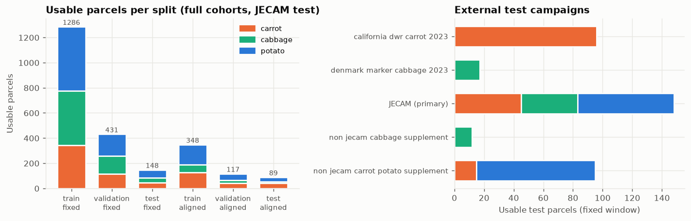
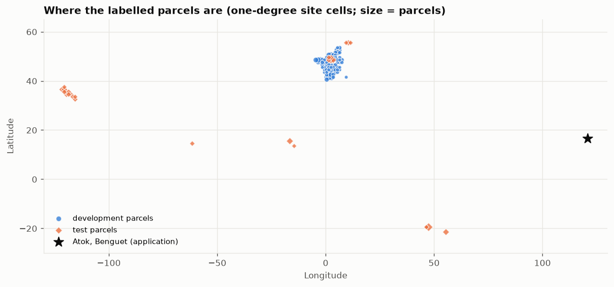

# 01 Data: labelled parcels and imagery

**Question:** which labelled parcels do we have, where are they, and how much imagery comes with them?

## What happens

1. **Audit the references** ([Collection 01](../../../notebooks/data_collection/01_external_reference_audit.ipynb)).
   Check the label sources and choose which collections are needed.
2. **Collect development parcels** (Collection 02 Sen4AgriNet, 03 FranceCrops, 04 EuroCrops). For each
   source, parcels are sampled per crop, and a full year of Sentinel-2 imagery (SR Harmonized, cloud
   probability below 40%, scene-classification masks) is downloaded as annual TIFFs, up to 20 pixels per
   parcel. Each parcel group is locked to train or validation at collection (seed 42) and never moves.
3. **Collect test parcels** (Collection 05 CropHarvest JECAM, the primary test; 05–07 supplements:
   non-JECAM CropHarvest, California DWR carrot, Denmark Marker cabbage). Test parcels are screened against
   development footprints so the same field cannot appear on both sides.
4. **Summarise** (Collection 08). Collection counts are candidates; usable counts come only after
   preprocessing (stage 02).

Collection is resumable: batches, ledgers and TIFFs are preserved, and rerunning with the same settings only
fills in what is missing. Preprocessing reads a snapshot of the finished collection, never live state.

## Hand-off to stage 02

Annual TIFFs, field masks, timelines and the locked assignments per parcel group, recorded in the
collection snapshot that Preprocessing 01 verifies.

## What today's run contains

Usable parcel counts after preprocessing (audit `external_epbjofk7`, `usable_samples.csv` and
`test_population_coverage.csv`):

| Cohort | Split | Carrot | Cabbage | Potato | Target per crop |
| --- | --- | ---: | ---: | ---: | ---: |
| Fixed full | train | 344 | 433 | 509 | 60 |
| Fixed full | validation | 115 | 145 | 171 | 20 |
| Fixed full | JECAM test | 45 | 38 | 65 | 20 |
| Aligned full | train | 125 | 65 | 158 | 60 |
| Aligned full | validation | 42 | 22 | 53 | 20 |
| Aligned full | JECAM test | 40 | 12 | 37 | 20 |

Development parcels come from Europe (Sen4AgriNet, FranceCrops, EuroCrops). JECAM, the primary test, is in
Madagascar (114 parcels) and Senegal (34); the supplements add California carrot, Danish cabbage and parcels from France, Réunion and Martinique
(fixed-window counts). Atok, where the model is applied, is far from all of them:

## Limits to keep in mind

- **Geography:** every development parcel is European. The model learns European growing seasons.
- **Labels:** all 1,717 fixed-full development parcels are `reported` labels (declarations or survey
  labels), none field-confirmed. The training weights would give confirmed labels 1.0 and reported 0.5, so
  here every parcel carries the same weight.
- **Test coverage:** JECAM parcels are small (often one to five pixels), so every test cohort misses the
  400-pixel target, and aligned-window JECAM cabbage (12 parcels) also misses the 20-parcel target. Per-crop
  test scores are therefore uncertain.
