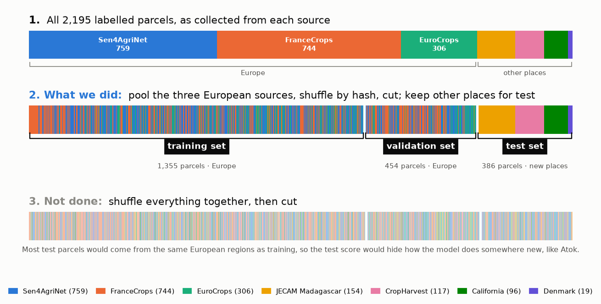
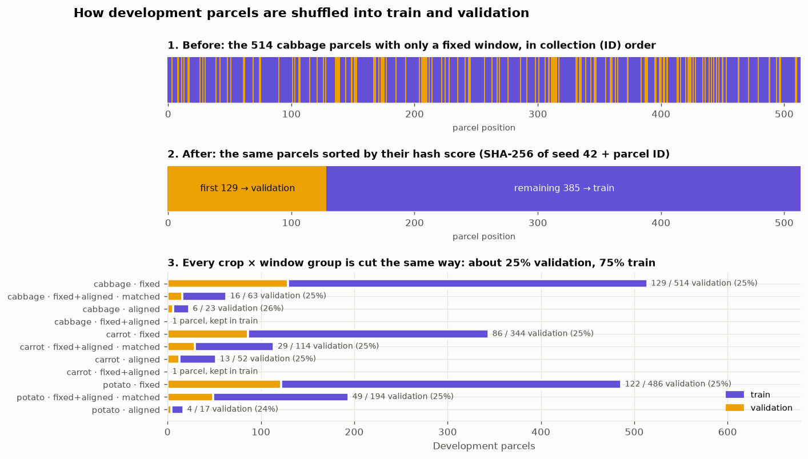
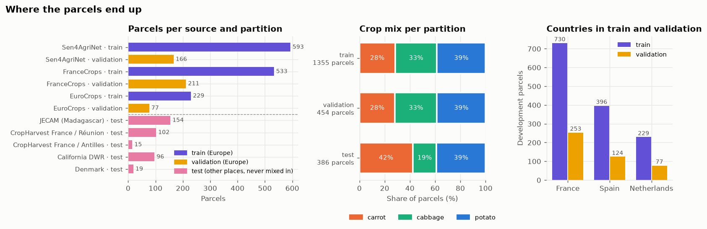
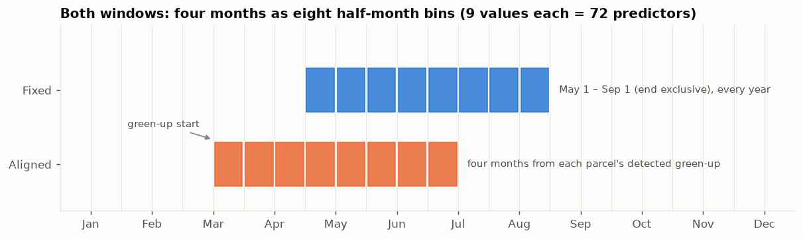
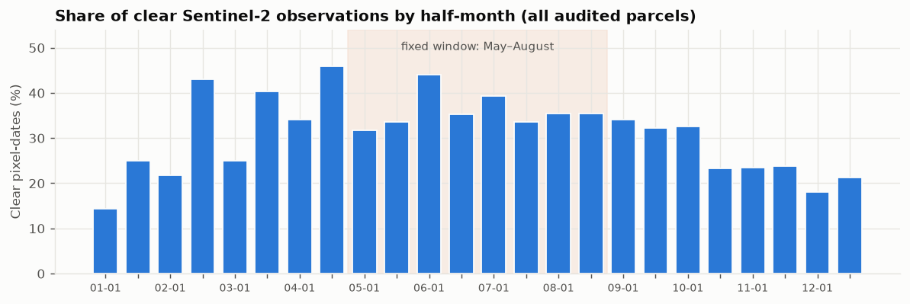
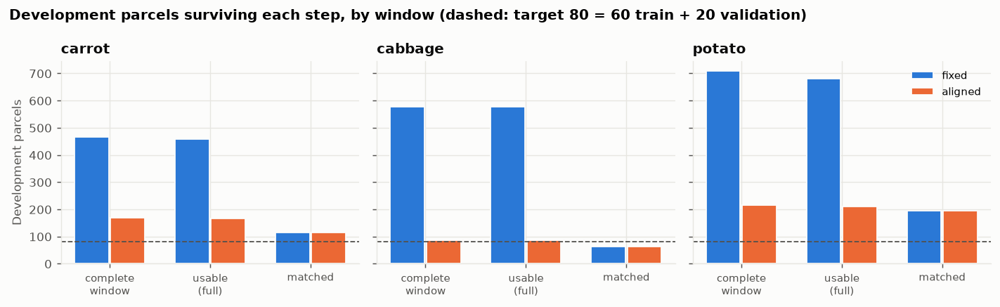

# 02 Preprocessing: quality, windows and predictors

**Question:** which parcels have clean enough imagery, in which four-month window, and what does the
model actually see?

## What happens

1. **Imagery quality** ([Preprocessing 01](../../../notebooks/preprocessing/01_imagery_quality.ipynb)).
   Audits every development and reserved test parcel against the collection snapshot: valid pixels per
   half-month after cloud, shadow and scene-edge masks. Writes `quality.json`.
2. **Window selection** ([Preprocessing 02](../../../notebooks/preprocessing/02_window_selection.ipynb)).
   Two recipes, each four months as eight half-month bins:
   - **Fixed:** May 1 to September 1 (end exclusive) in every observation year.
   - **Aligned:** four months starting at each parcel's detected green-up, with automatic timing checks.
   A bin counts only if at least 80% of the parcel's pixels are valid; all eight bins must be complete.
3. **Features** ([Preprocessing 03](../../../notebooks/preprocessing/03_feature_engineering.ipynb)).
   Per bin, five bands (B3, B4, B5, B8, B11) and four indices (NDVI, NDRE, NDMI, SAVI): 8 × 9 = 72
   predictors per pixel. Up to 20 pixels per parcel. Pixel locations shared by different development
   parcels (the same farmland in another year) are removed before capping. **Matched cohorts** keep only
   locations that qualify in both windows, so fixed and aligned can be compared on identical pixels.
   Development parcels are then locked to train or validation by parcel group (`development_split.json`,
   policy `matched_first`), and test parcels stay separate.

   The three European sources are pooled first. Within each crop × window group, parcels are ordered by a
   hash of seed 42 and the parcel ID (a shuffle that gives the same order on every run). The first 25% go to
   validation and the rest to train. Whole parcels move, so a field's 20 pixels never sit on both sides.

   

   

   

   Test parcels come from other places (JECAM Madagascar, CropHarvest, California, Denmark). They are
   never pooled with development parcels.
4. **Checks** (Preprocessing 04 cabbage test windows, 05 matched coverage) report coverage; they do not
   change the export.

## Hand-off to stage 03

`features_development.json` and `features_test.json` with the locked split, `usable_samples.csv`
(counts and shortfalls) and sealed stage receipts. Training never reads live collection state.

## What today's run shows

Clear observations are scarce in every half-month: at best about 46% of pixel-dates are clear, and in
January only 14% (audit `external_epbjofk7`, `observation_loss_by_half_month.csv`). Inside the fixed
May–August window the clear share ranges from 32% to 44%.

The aligned window keeps far fewer parcels than the fixed one, because a green-up has to be detected and
its whole four months must be clear. Matching then keeps only pixel locations that qualify in both
windows. Development parcels at each step (`window_counts.csv`, `usable_samples.csv`):

| Crop | Complete fixed window | Complete aligned window | Usable fixed (train + val) | Usable aligned (train + val) | Matched (train + val) |
| --- | ---: | ---: | ---: | ---: | ---: |
| Carrot | 465 | 169 | 459 | 167 | 114 |
| Cabbage | 578 | 87 | 578 | 87 | 63 |
| Potato | 710 | 215 | 680 | 211 | 194 |

Matched cabbage (47 train, 16 validation) misses the 60 + 20 parcel target; the shortfall is reported, and
labels, windows and quality rules are not relaxed to fill it.

## Limits to keep in mind

- **Season assumption:** the fixed window assumes a European May–August crop. Atok grows crops year-round in
  short cycles, so the same calendar window describes different growth stages there.
- **Aligned coverage:** requiring a detected green-up and a fully clear window removes most parcels; the
  aligned results rest on far fewer parcels.
- **20 m bands:** B5 and B11 are 20 m bands resampled to 10 m; this adds no spatial detail.
