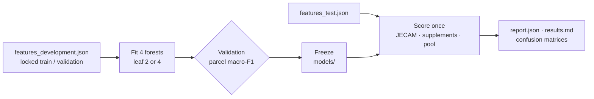
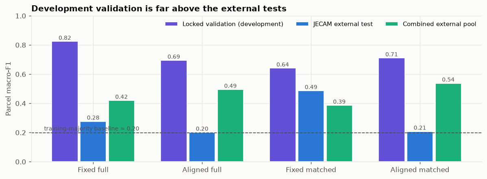
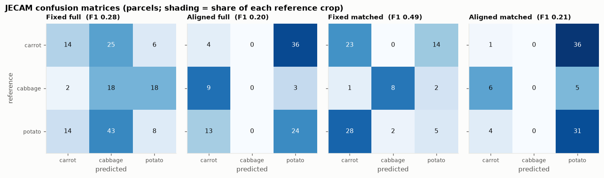

# 03 Models: train, select, freeze and test

**Question:** how well do the frozen Random Forests separate carrot, cabbage and potato, first on held-back
development parcels and then on external parcels from other countries?

## What happens

1. **Train and validate** ([Training 01](../../../notebooks/training/01_train_and_validate.ipynb)). Four
   models, one per cohort: fixed full, aligned full, fixed matched and aligned matched. Each is a Random
   Forest with 1,000 trees, seed 42, square-root feature sampling and a weighted half-size bootstrap, fitted
   on the training parcels only. The minimum leaf size (2 or 4) is chosen on **validation parcel macro-F1**;
   pixel probabilities are averaged per parcel. Today every cohort selected leaf size 2.
2. **Freeze** ([Training 02](../../../notebooks/training/02_freeze_models.ipynb)). The selected models are
   copied, with their recipes and checksums, into `models/`. Nothing is refitted after this point.
3. **External test** ([Testing 01](../../../notebooks/testing/01_external_test_evaluation.ipynb)). Each
   frozen model scores the matching test features once: JECAM (primary), each supplement and the combined
   pool. A training-majority baseline (always "potato") is scored alongside.
4. **Diagnostics** ([Testing 02](../../../notebooks/testing/02_results_and_diagnostics.ipynb)). Per-crop
   precision, recall and F1, confusion matrices and coverage. A three-class macro-F1 is reported only when
   all three crops are present.

## What today's run shows

Training `run_79cc09f61c3e`, testing `run_78548ef86423` (parcel macro-F1; the majority baseline scores about
0.20 on JECAM):

| Model | Locked validation | JECAM | Combined pool | JECAM carrot F1 | JECAM cabbage F1 | JECAM potato F1 |
| --- | ---: | ---: | ---: | ---: | ---: | ---: |
| Fixed full | 0.823 | 0.276 | 0.419 | 0.37 | 0.29 | 0.16 |
| Aligned full | 0.694 | 0.200 | 0.494 | 0.12 | 0.00 | 0.48 |
| Fixed matched | 0.640 | 0.486 | 0.385 | 0.52 | 0.76 | 0.18 |
| Aligned matched | 0.710 | 0.207 | 0.537 | 0.04 | 0.00 | 0.58 |

The gap between validation and the external tests is the main result: European validation parcels look like
the training parcels, the external ones do not. Only the fixed matched model is clearly above the majority
baseline on JECAM. The aligned models never predict cabbage on JECAM and send most carrot to potato:

The combined-pool column here covers every external parcel each model scored. Stage 04 compares models on
the 175 parcels that every comparison model scored (the revised reporting scope), so its numbers differ
slightly (fixed matched 0.391 there, 0.385 here).

## Limits to keep in mind

- External scores are retrospective: these parcels were examined while the project developed.
- JECAM has 83–148 parcels per model and few cabbage parcels, so one parcel moves a crop's F1 noticeably.
- Validation uses European parcels from the same sources as training; it overstates performance elsewhere
  (stage 04 shows why).
