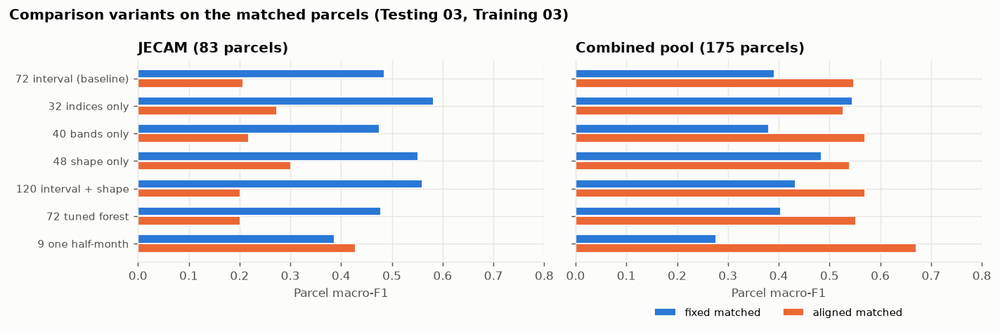
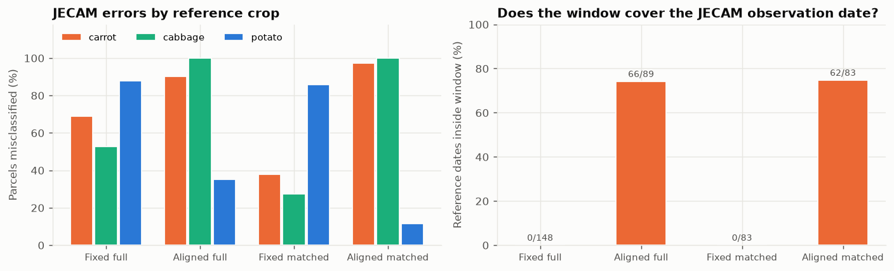
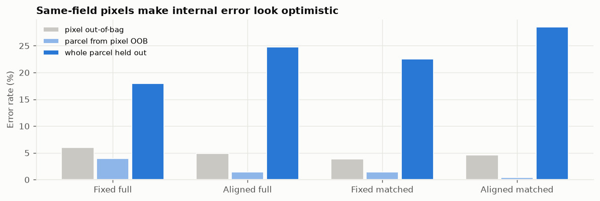
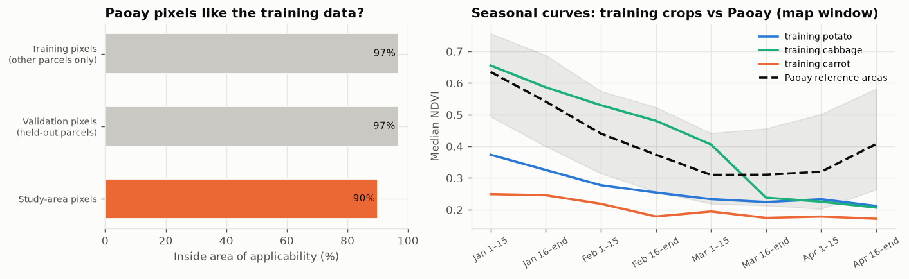

# 04 Limits and error analysis

**Question:** why do the models fail on external parcels, would other predictors or settings have helped,
and where does the model stop being trustworthy?

## What happens

| Step | Notebook / tool | What it does |
| --- | --- | --- |
| Comparator models | [Testing 03](../../../notebooks/testing/03_model_comparisons.ipynb) | Refits the matched forests with fewer or different predictors (one half-month, bands only, indices only, curve shape, interval + shape) on the same parcels, freezes them and scores them once |
| Tuning | [Training 03](../../../notebooks/training/03_matched_model_tuning.ipynb) | Tries one-setting forest changes, chosen by five geographic folds inside training only |
| Error analysis | [Testing 04](../../../notebooks/testing/04_error_analysis_and_diagnostics.ipynb) | Joins every external prediction to its pixels, window, observation date and imagery support; out-of-bag error; grouped feature importance |
| Applicability | [Paoay 03](../../../notebooks/paoay/03_model_application.ipynb) | Dissimilarity of Paoay pixels to the training pixels (area of applicability), and seasonal curves of training crops against Paoay |

Testing 03, Training 03 and Testing 04 also read saved results that existed only on Jose's machine. For a
local run they are rebuilt with
[`rebuild_matched_feature_comparison.py`](../../../tools/rebuild_matched_feature_comparison.py),
[`rebuild_shape_archive.py`](../../../tools/rebuild_shape_archive.py) and
[`build_test_reference_audit.py`](../../../tools/build_test_reference_audit.py). Jose's notebooks and
reported results are unchanged; the values below are today's local reruns on testing run `run_78548ef86423`.

## Would other predictors or settings help?

Matched cohorts, so every model is scored on the same parcels (83 JECAM, 175 in the combined pool):

| Variant | Fixed: validation | Fixed: JECAM | Fixed: combined | Aligned: validation | Aligned: JECAM | Aligned: combined |
| --- | ---: | ---: | ---: | ---: | ---: | ---: |
| 72 interval (baseline) | 0.640 | 0.486 | 0.391 | 0.710 | 0.207 | 0.548 |
| 32 indices only | 0.664 | 0.582 | 0.545 | 0.688 | 0.273 | 0.527 |
| 40 bands only | 0.607 | 0.475 | 0.381 | 0.657 | 0.218 | 0.569 |
| 48 shape only | 0.693 | 0.552 | 0.484 | 0.706 | 0.302 | 0.540 |
| 120 interval + shape | 0.714 | 0.560 | 0.433 | 0.728 | 0.202 | 0.569 |
| 72 tuned forest | 0.627 | 0.479 | 0.404 | 0.674 | 0.202 | 0.552 |
| 9 one half-month | 0.518 | 0.387 | 0.276 | 0.544 | 0.428 | 0.671 |

- **Fixed window:** indices-only, shape-only and interval + shape all beat the 72-predictor baseline on both
  external tests. Simpler, ratio-based predictors seem to travel better than raw reflectance.
- **Aligned window:** no variant fixes JECAM (0.20–0.43). The one-half-month model has the highest combined
  score (0.671) but this comes from the supplements' timing; it is weak on JECAM.
- **Tuning:** Training 03 chose leaf size 8 (fixed) and 4 (aligned) on geographic folds; on JECAM the tuned
  forests change macro-F1 by −0.007 and −0.005. Forest settings are not the problem.

## Why do the models fail?

- **Wrong part of the season.** For JECAM parcels with a recorded observation date, none falls inside the
  fixed May–August window (0/148 full, 0/83 matched), against 66/89 and 62/83 inside the aligned window.
  The fixed model often classifies a period when the labelled crop is not in the field.
- **Crop-specific failure.** The fixed models miss most JECAM potato (85–88% wrong); the aligned models miss
  almost all carrot and every cabbage.
- **Internal error is optimistic.** Out-of-bag error measured on pixels is 4–6%, because pixels from the same
  field are in and out of the bag together. Holding out whole parcels gives 18–29%:

| Model | Pixel OOB error | Parcel from pixel OOB | Whole parcel held out |
| --- | ---: | ---: | ---: |
| Fixed full | 6.0% | 4.0% | 17.9% |
| Aligned full | 4.8% | 1.4% | 24.7% |
| Fixed matched | 3.9% | 1.5% | 22.5% |
| Aligned matched | 4.6% | 0.4% | 28.5% |

## Where is the model trustworthy?

The Paoay map model is scored for its **area of applicability**: how far each pixel's predictors are from the
nearest training pixel, against the spread inside the training data. 90% of Paoay pixels fall inside it, against
97% of training and validation pixels. Being inside means the model is not extrapolating; it does not mean the
label is right. The seasonal curves show why: Paoay's January–April NDVI (dashed) does not follow any single
training crop.

These checks come from the Paoay map model, a fixed-window model trained on a January–April window
(training run `run_2170184fb6b8`, set by `paoay_model_manifest`), not the May–August models above; see stage 05.

## What this means

The external gap is mostly a **timing and geography** problem, not a forest-settings problem. Predictors that
describe the curve's shape or index ratios transfer somewhat better; tuning does not. These comparisons use
parcels that were already examined, so they suggest directions for the field visit, not a new model choice.
