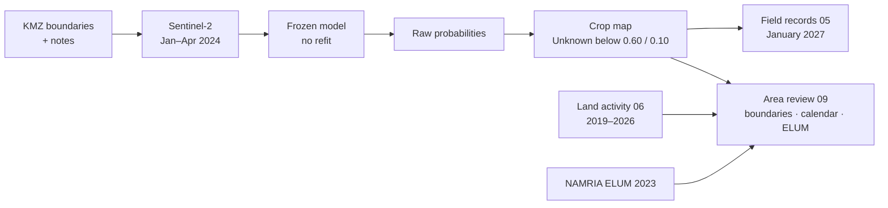
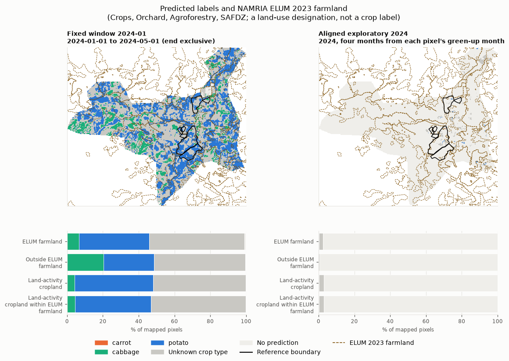
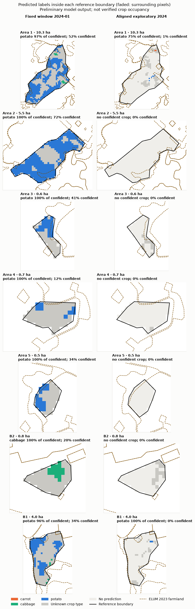
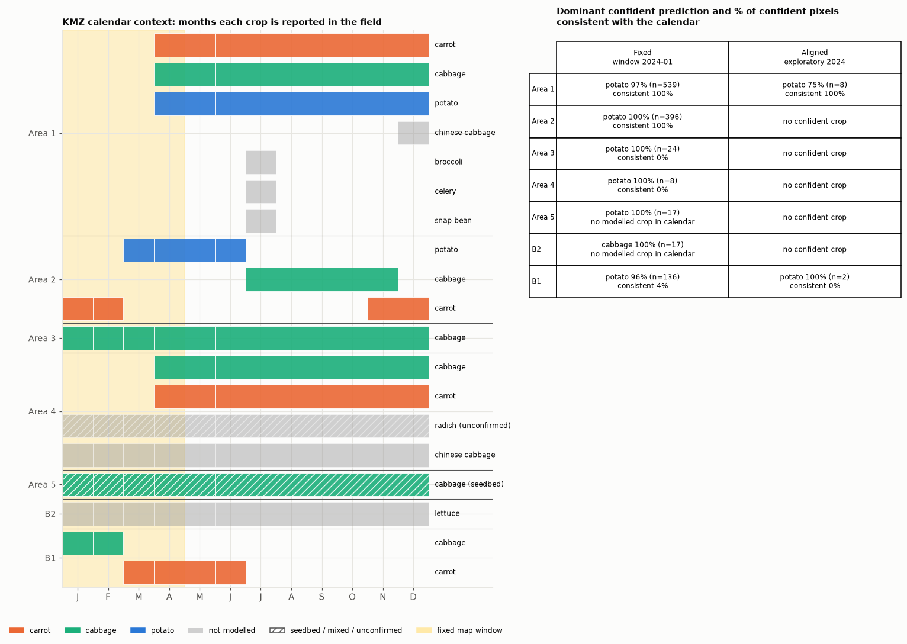

# 05 Atok application: Paoay maps, calendar context and land use

**Question:** what does the frozen model say about the Paoay study area in Atok, Benguet, and how does that
sit with what farmers report and with the land-use map?

There are no dated local crop labels yet, so nothing in this stage is an accuracy estimate.

## What happens

| Notebook | What it does |
| --- | --- |
| [Paoay 01](../../../notebooks/paoay/01_reference_review.ipynb) | Reads the KMZ files: study boundary, Atok boundary and the seven reference areas (Area 1–5, B1, B2) with their notes |
| [Paoay 02](../../../notebooks/paoay/02_satellite_inputs.ipynb) | Sentinel-2 composites for January–April 2024 with the training recipe, plus Dynamic World context |
| [Paoay 03](../../../notebooks/paoay/03_model_application.ipynb) | Applies the frozen fixed-window model without refitting, then the area-of-applicability and seasonal-curve checks (stage 04) |
| [Paoay 04](../../../notebooks/paoay/04_maps.ipynb) | Crop map with Unknown below 0.60 top probability or 0.10 margin; screening flags (weak vegetation, water, built, woody, bare), never hard exclusions |
| [Paoay 05](../../../notebooks/paoay/05_reference_field_review.ipynb) | Freezes the preliminary map and prepares the January field-observation records |
| [Paoay 06](../../../notebooks/paoay/06_land_activity.ipynb) | 2019–2026 land activity (active cropland, mixed, perennial, bare/built) checked against NAMRIA ELUM 2023 |
| [Paoay 07](../../../notebooks/paoay/07_aligned_exploratory_map.ipynb) | Exploratory map with the aligned matched model and per-pixel green-up windows |
| [Paoay 09](../../../notebooks/paoay/09_area_review.ipynb) | Predicted labels inside each reference boundary, the KMZ crop calendars against the predictions, and NAMRIA ELUM 2023 farmland |

**Which model draws the map.** The Paoay map uses `paoay_model_manifest` from the local settings: a fixed
full model trained on a **January–April** window (training run `run_2170184fb6b8`, locked validation
macro-F1 0.788), matching the 2024 January–April imagery. It is not the May–August model of stage 03. The
aligned map uses the aligned matched model of the current training run.

## The map and land use

In land-activity cropland the fixed map is confident on 48% of pixels, and those confident calls are 91% potato,
9% cabbage and almost no carrot. The aligned map is confident on almost nothing (0.2%): few pixels have a
detected green-up with a fully clear four-month window.

NAMRIA ELUM 2023 "Crops" covers 88–100% of every reference area. Inside ELUM farmland the fixed map calls 39%
potato and 7% cabbage; outside it, 28% potato and 21% cabbage. That cabbage outside farmland is a warning sign:
the model gives a confident crop label to land the land-use map does not class as farmland.

| Fixed map (Paoay study area) | Potato | Cabbage | Carrot | Unknown |
| --- | ---: | ---: | ---: | ---: |
| Inside ELUM farmland | 39.1% | 6.7% | 0.0% | 53.3% |
| Outside ELUM farmland | 28.0% | 20.5% | 0.0% | 51.2% |
| Land-activity cropland | 43.8% | 4.3% | 0.0% | 51.8% |

## Each reference area

## Calendar context

The KMZ notes give crop calendars for each area (planting to harvest). They say when a crop is usually in the
field, not what grew in 2024, so agreement is context only. A confident pixel counts as consistent when its
crop has a calendar entry for that area overlapping the map's January–April window.

| Area | Calendar crops in Jan–Apr | Fixed map: dominant confident crop | Consistent |
| --- | --- | --- | ---: |
| Area 1 | cabbage, carrot, potato (from April) | potato (97%) | 100% |
| Area 2 | carrot, potato | potato (100%) | 100% |
| Area 3 | cabbage | potato (100%) | 0% |
| Area 4 | cabbage, carrot (from April) | potato (100%) | 0% |
| Area 5 | cabbage seedbeds only | potato (100%) | — |
| B2 | lettuce only (not modelled) | cabbage (100%) | — |
| B1 | cabbage (Jan–Feb), carrot (Mar–Jun) | potato (96%) | 4% |

Overlap is generous: Area 1's potato calendar runs April–December, so a single April half-month makes potato
"consistent". Where the calendar names only cabbage (Area 3) or cabbage and carrot (Area 4, B1), the map still
says potato.

## Limits to keep in mind

- Forced choice: every pixel is scored as carrot, cabbage or potato, including lettuce, radish, seedbeds and
  forest. Unknown is score rejection, not "other crop".
- The model was trained on European parcels and a single four-month window; Atok's short, overlapping cycles
  are a different pattern (stage 04).
- Calendars, ELUM and land activity are context. Only the dated January 2027 observations recorded through
  Paoay 05 can test the map.
