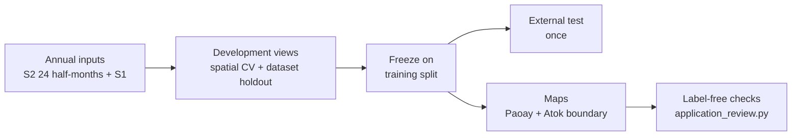
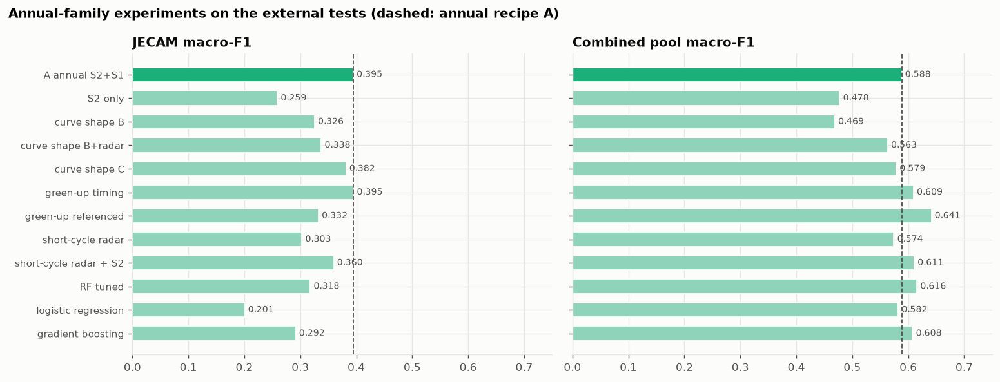
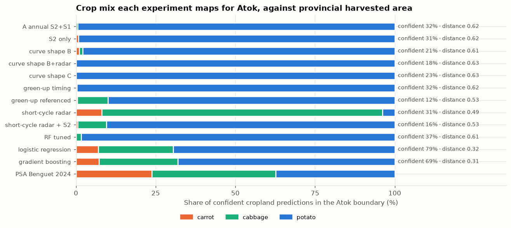
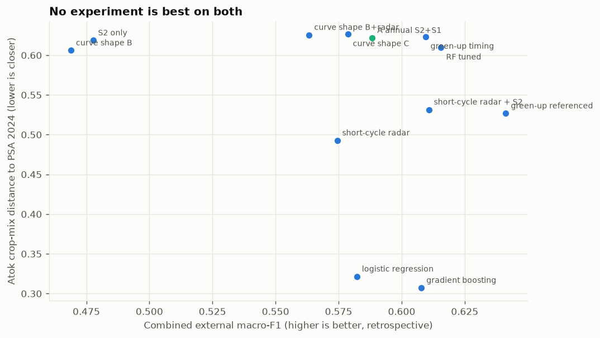
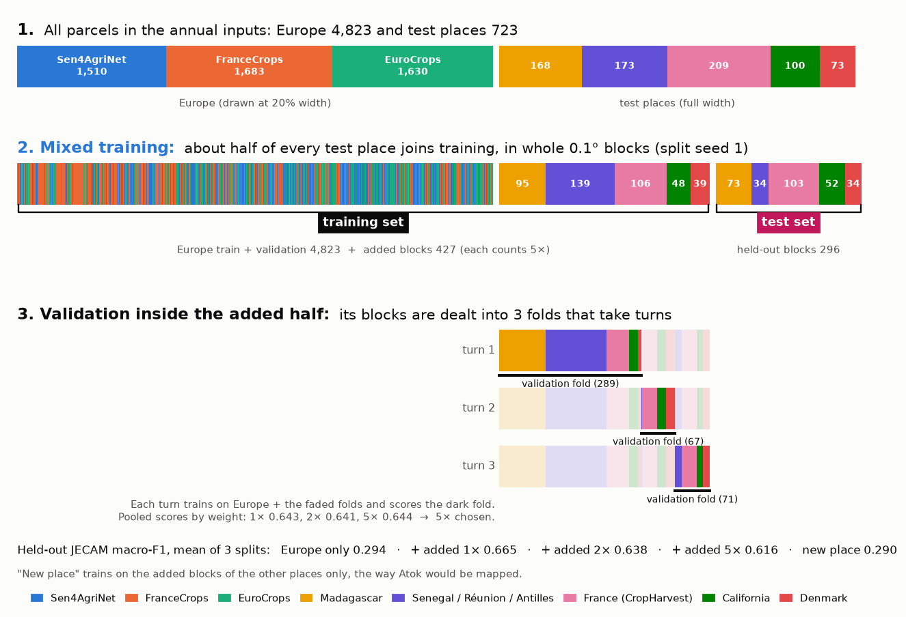

# 06 Experiments: the annual recipe and its variants

**Question:** can a model that needs no four-month window do better, on the external tests and on the Atok
map?

Everything here lives in [`experiments/`](../../../experiments/README.md). For a plain-language walkthrough of every
experiment, open [`experiments_explained.ipynb`](../../../experiments/notebooks/experiments_explained.ipynb). Experiments read the reported runs
but never change them; their models are not part of the reported pipeline.

## The annual recipe

Instead of one four-month window, the annual recipe describes each pixel's **whole year**: harmonic curves
fitted to the 24 half-month Sentinel-2 composites, optionally with Sentinel-1 radar at the same pixels. It
needs at least 12 clear half-months with no gap over three months, and no green-up date. It keeps its own
train/validation split (the collection-time lock, covering all 4,843 development parcels), because Jose's
Preprocessing 03 split only covers parcels with a qualifying window.

Every variant goes through the same stages, each with sealed receipts
([`rerun_experiments.py`](../../../experiments/annual/rerun_experiments.py)):

| Experiment | What changes |
| --- | --- |
| A annual S2+S1 | Reference version: Sentinel-2 and Sentinel-1 harmonics, default Random Forest |
| S2 only | No radar |
| Curve shape B / B+radar / C | The external study's curve-shape descriptors instead of, beside, or added to the harmonics |
| Green-up timing / referenced | Adds each pixel's green-up timing, or measures the curves from its green-up instead of 1 January |
| Short-cycle radar / + S2 | Describes only the strongest four-month radar crop cycle, for Atok's short cycles |
| RF tuned, logistic regression, gradient boosting | Same predictors as A; the classifier changes, tuned by spatial CV in training |

## External tests

Rerun of 22 November 2026 (`pipeline_outputs/experiments/rerun_20261122/experiments.json`); 88,716
development pixels shared by every recipe:

| Experiment | Selection score | Locked validation | JECAM | Combined pool |
| --- | ---: | ---: | ---: | ---: |
| A annual S2+S1 | 0.789 | 0.923 | 0.395 | 0.588 |
| S2 only | 0.732 | 0.896 | 0.259 | 0.478 |
| Curve shape B | 0.731 | 0.914 | 0.326 | 0.469 |
| Curve shape B+radar | 0.761 | 0.932 | 0.338 | 0.563 |
| Curve shape C | 0.761 | 0.939 | 0.382 | 0.579 |
| Green-up timing | 0.782 | 0.926 | 0.395 | 0.609 |
| Green-up referenced | 0.753 | 0.916 | 0.332 | 0.641 |
| Short-cycle radar | 0.720 | 0.851 | 0.303 | 0.574 |
| Short-cycle radar + S2 | 0.771 | 0.920 | 0.360 | 0.611 |
| RF tuned (half features) | 0.802 | 0.933 | 0.318 | 0.616 |
| Logistic regression (C = 1) | 0.804 | 0.922 | 0.201 | 0.582 |
| Gradient boosting (depth 6, rate 0.05, 300 trees) | 0.814 | 0.942 | 0.292 | 0.608 |

The best development scores (gradient boosting, logistic regression) are among the worst on JECAM; development
selection does not predict transfer. Against Jose's models on the same 83 JECAM parcels, the annual recipe A is
below the fixed matched model (0.372 vs 0.486) and close to the aligned models on the combined pool
([`compare_models.py`](../../../experiments/annual/compare_models.py),
`pipeline_outputs/reports/experiments_vs_jose_run_78548ef86423/`).

## Atok application

Each experiment's map over the Atok boundary, checked without labels
([`application_review.py`](../../../experiments/annual/application_review.py)): the confident share of cropland,
the confident crop mix against PSA's 2024 Benguet harvested area (cabbage 39%, potato 37%, carrot 24%), and
the share of pixels outside the training range.

| Experiment | Confident share of cropland | Crop mix (carrot / cabbage / potato) | Distance to PSA mix | Outside training range |
| --- | ---: | --- | ---: | ---: |
| A annual S2+S1 | 32% | 0 / 0 / 100 | 0.62 | 60% |
| Curve shape B+radar | 18% | 0 / 0 / 100 | 0.63 | 4% |
| Green-up referenced | 12% | 0 / 10 / 90 | 0.53 | 63% |
| Short-cycle radar | 31% | 8 / 88 / 4 | 0.49 | 76% |
| Logistic regression | 79% | 7 / 24 / 69 | 0.32 | 60% |
| Gradient boosting | 69% | 7 / 25 / 68 | 0.31 | 60% |

The full table for all twelve is in [`experiments/README.md`](../../../experiments/README.md#rerun-on-22-november-2026).

- Most variants map Atok as almost all potato, which does not fit the provincial mix.
- Gradient boosting and logistic regression give the most confident, most mixed maps, closest to the provincial
  mix, but they are weak on JECAM.
- Short-cycle radar maps mostly cabbage and agrees most with the KMZ calendars, but three quarters of Atok is
  outside its training range.
- The curve-shape recipes stay closest to the training data, yet still call almost everything potato.

## Mixed training: some test places in training

What happens if part of each test place joins training ([`weighted.py`](../../../experiments/mixed_training/weighted.py),
run `pipeline_outputs/mixed_training/weighted_20261122/`, annual recipe A predictors)?

- **Split by place, not parcel:** about half of every test place goes into training as whole 0.1° blocks
  (about 10 km). The other half is held out and scored once.
- **Validation:** the added half's blocks are dealt into three folds that take turns. The pooled score picks
  how much an added parcel counts: 1×, 2× or 5× a European parcel.
- **Repeats:** three split seeds.

Adding nearby blocks lifts the held-out JECAM score from about 0.29 to 0.62–0.67. Training on the *other*
places only ("new place", the situation Atok is in) stays at about 0.29. The gain comes from having labelled
fields near the test fields, which is why the dated January 2027 Atok observations matter.

No experiment is best on both the external tests and the Atok checks. Province statistics are a weak reference
for one municipality, and none of these checks measures accuracy. Gradient boosting is the strongest candidate
to take to the January 2027 field visit beside Jose's fixed model; the dated field observations decide.
