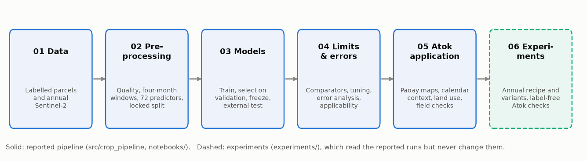
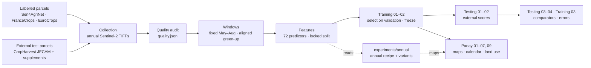

# How the pipeline works, stage by stage

This guide walks through the crop classification pipeline from labelled parcels to the Atok map,
one folder per stage. Each folder explains what the stage does, which notebooks and modules run it,
what it hands to the next stage, and what today's run produced, with figures.



| Stage | What it answers | Run with |
| --- | --- | --- |
| [01 Data](01_data/README.md) | Which labelled parcels and imagery do we have? | `notebooks/data_collection/01–08` |
| [02 Preprocessing](02_preprocessing/README.md) | Which parcels have clean imagery, in which window, with which predictors? | `notebooks/preprocessing/01–05` |
| [03 Models](03_models/README.md) | How well do the frozen Random Forests do on validation and on external tests? | `notebooks/training/01–02`, `notebooks/testing/01–02` |
| [04 Limits and errors](04_limits_and_errors/README.md) | Why do they fail, and where does the model stop being trustworthy? | `notebooks/testing/03–04`, `notebooks/training/03`, Paoay 03 checks |
| [05 Atok application](05_atok_application/README.md) | What does the model say about Paoay and Atok, and how does that sit with local context? | `notebooks/paoay/01–07`, `09` |
| [06 Experiments](06_experiments/README.md) | Do the annual-recipe experiments do better, on the tests and on the Atok map? | `experiments/notebooks/annual/`, `experiments.annual.*` |



## Reading the numbers

- **Every value comes from a run.** The figures are drawn by
  [`tools/build_pipeline_guide.py`](../../tools/build_pipeline_guide.py) from the saved run files, located
  through the current stage pointers. [`figure_sources.json`](figure_sources.json) lists, for each figure,
  the files it read and their SHA-256. Rerun the script after a new run to refresh every figure:

  ```bash
  .venv/bin/python tools/build_pipeline_guide.py
  ```

- **The runs behind this version** (22 November 2026): preprocessing audit `external_epbjofk7`, training
  `run_79cc09f61c3e`, testing `run_78548ef86423`, experiment rerun `pipeline_outputs/experiments/rerun_20261122`.
  Raw data and run outputs stay out of Git; only the figures and this text are committed.
- **External scores are retrospective.** The external parcels have been looked at while the project
  evolved, so they describe this benchmark, not a fresh held-out test.
- **Nothing here measures accuracy in Atok.** No dated local crop labels exist yet. The Atok checks are
  plausibility and context only; the January 2027 field visit is the independent test.

Colours: carrot orange, cabbage aqua, potato blue in every figure; the fixed window is blue and the
aligned window orange where windows are compared.
